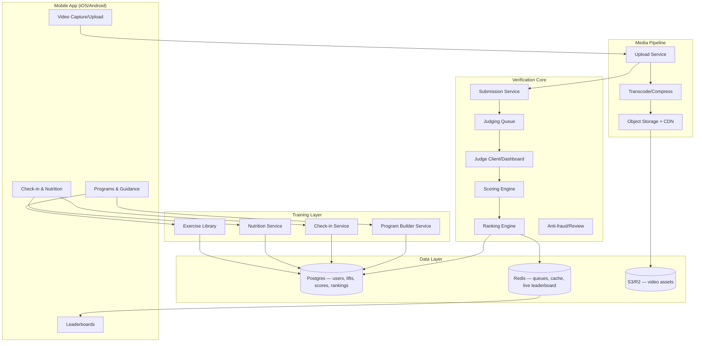

# Powerlifting Rank App — Technical Architecture

## 1. What kind of system this actually is

Split the product into two halves, because they have completely different engineering demands:

| Half | What it does | Hard part |
|---|---|---|
| **Verification Core** | Video submission → judging → score → leaderboard (local/state/national/global) | Trust, fraud-resistance, judge scaling, fair cross-bodyweight comparison |
| **Training Layer** | Exercise guidance, program builder, daily check-ins, nutrition | Standard CRUD + content, not novel |

The Verification Core is your actual differentiator — it's what nobody else has. The Training Layer is what makes people open the app daily. Build in that order: **Core first**, because without a credible ranking system this is just another fitness tracker.

---

## 2. High-level architecture



---

## 3. Recommended tech stack (React + Node throughout)

**Frontend**
- React (Next.js) for the web app — server-rendered pages for leaderboards/SEO, client-rendered for the interactive parts (video review, program builder). If a native mobile app comes later, React Native shares components and logic with this.

**Backend**
- Node.js (NestJS or Express) for the API layer. Keeping backend and CV in the same language (JavaScript/TypeScript) matters here specifically because TensorFlow.js pose-estimation models (§6) run natively in Node — you don't need a separate Python service just for the CV pipeline.
- Postgres as the primary database, with the **pgvector** extension enabled for the RAG rulebook (§5) — no separate vector database needed.
- Redis for the judging queue, session cache, and live leaderboard reads.
- S3-compatible object storage (Cloudflare R2 is cheaper than S3 for egress) + a CDN in front of it.
- A managed video transcoding service (Mux, or Cloudflare Stream) rather than building your own.

**Judging interface**
- A separate internal Next.js dashboard for judges — a fast review queue with CV-flagged suggestions surfaced per submission (§6), not a consumer UI.

---

## 4. RAG for the rulebook

This is the easy win in the whole system — the rulebook is structured, stable text, which is exactly what RAG is good at.

1. **Ingest**: split the federation's technical rulebook (e.g. IPF Technical Rules) into rule-sized chunks — by clause/section, not arbitrary character counts, so each chunk is a complete thought.
2. **Embed**: generate embeddings for each chunk (OpenAI or Voyage embeddings both work well) and store them in Postgres with pgvector.
3. **Retrieve + answer**: when a lifter or judge asks a question ("is a double-bounce at the bottom always a no-lift?"), embed the question, retrieve the top-k matching rule chunks, and pass them to an LLM with an instruction to answer *only* from the retrieved text and cite the clause.
4. **Where to use it**: judge onboarding/training, an in-app "ask the rulebook" feature for lifters prepping for a meet, and — usefully — as a grounding source for the CV judging system below, so a flagged issue can link back to the actual rule it's checking against.

This part is low-risk: worst case, a bad retrieval gives a slightly off-topic answer, not a wrong ranking.

---

## 5. Judging pipeline: CV-first, RAG-checked, human batch review (paid tier)

This is the refined flow: CV runs on every submission automatically; a human judge is not required to get a result. Humans come in as a **weekly batch pass**, gated behind a subscription — which also solves the judge-availability problem, since you don't need judges on standby.

**At upload:**
1. The lifter submits the video **plus** answers to the same rule-checkpoint questions the self-checklist already asks (depth, pause, lockout, bar path, etc.) — this pairs a fast structured signal with the raw footage.
2. **CV pass** (TensorFlow.js pose models, running in Node — see §4 for the earlier stack rationale): extracts joint landmarks per frame and computes:
   - **Depth** — hip-y vs knee-y at the identified turnaround frame.
   - **Tempo** — time from first movement to lockout, plus the split between descent/pause and drive phases (your "time from start to done" requirement).
   - **Leg and joint tracking** — knee path, ankle stability, elbow lockout symmetry, bar path drift — whichever set applies to the lift type.
3. **RAG cross-check**: the lifter's own checklist answers are compared against what the CV pass actually measured *and* against the retrieved rulebook clause (§4's RAG system) for that checkpoint. A mismatch — e.g. the lifter said "yes, full lockout" but the CV read a bent-knee angle at the turnaround, or their answer conflicts with the specific rule text retrieved for that federation — gets **flagged**, not silently corrected. This is the part that catches both honest mistakes and gaming attempts.
4. The lifter gets an immediate automated verdict (good lift / no lift / flagged) with the CV readout, so there's no waiting on a human for basic feedback.

**Weekly human batch review (subscription-gated):**
5. Everything **flagged** by the RAG cross-check, plus a sample of top-ranking submissions (the ones that actually affect leaderboard position), queue up for a **weekly** human judge pass rather than per-submission review — this is what makes human judging viable without needing judges online continuously.
6. This weekly review is the paid tier: a small subscription unlocks "official verified" status on your lifts and ranking — free users get the CV-only automated read, which is useful for training feedback but doesn't carry the same weight on the competitive leaderboard.
7. A verified badge (human-confirmed) vs. an automated badge (CV-only) should be visibly distinct everywhere a score appears — on the lift result, the profile, and the leaderboard — so the ranking's credibility is legible at a glance, not just implied.

**Data model addition** (extends §6's `Score`/`JudgeReview` entities):
```
CVReading
 - id, submission_id, depth_result, tempo_start_to_lockout_s,
   descent_time_s, drive_time_s, joint_flags_json, confidence

RuleFlag
 - id, submission_id, checklist_item, lifter_answer, cv_finding,
   rulebook_clause_id (FK to the RAG-indexed rule chunk), status (open/resolved)

UserSubscription
 - user_id, tier (free/verified), renews_at, weekly_review_included (bool)
```

Sequence this as: ship the CV + RAG-flagging pipeline first (it's valuable standalone, as instant automated feedback), then build the weekly human review queue and subscription gate once you have submission volume to justify judge time.

---

## 6. Core data model

Rough entity list — enough to start an ERD, not final schema:

```
User
 - id, username, region_id, bodyweight_kg, sex, verified_status
 - created_at

Region
 - id, name, level (city/state/country/global), parent_region_id

LiftSubmission
 - id, user_id, lift_type (squat/bench/deadlift), video_url
 - claimed_weight_kg, bodyweight_at_submission_kg
 - status (pending/in_review/scored/rejected)
 - submitted_at

JudgeReview
 - id, submission_id, judge_id, verdict (good_lift/no_lift), notes
 - flagged_reason (depth/lockout/racking/bar_path/etc)
 - reviewed_at

Score
 - id, submission_id, raw_weight_kg, computed_score (see §5), method
 - finalized_at

Ranking (materialized/cached, not source of truth)
 - user_id, region_id, lift_type, rank, score, period

Judge
 - id, user_id, credential_level, submissions_reviewed, accuracy_rating

TrainingProgram
 - id, user_id, goal (squat/bench/deadlift/total), weeks, structure_json

CheckIn
 - id, user_id, date, bodyweight, sleep_hours, sleep_quality,
   water_intake_ml, energy_level, stress_level,
   cigarettes, alcohol_units, notes

NutritionPlan
 - id, user_id, diet_type (veg/non-veg/vegan), goal (cut/bulk/maintain),
   daily_calories, macro_targets_json
```

Key design call: **`Score` and `LiftSubmission` are separate from `Ranking`.** Rankings should be a *computed, cacheable, rebuildable* view — never the source of truth. This matters because you'll change your ranking formula over time, and you don't want that migration to be destructive.

---

## 7. The ranking problem (this is the part to get right)

You can't just rank by raw kg lifted — a 55kg lifter and a 110kg lifter aren't comparable on raw numbers. Powerlifting already solved this: use a bodyweight-adjusted formula.

- **DOTS score** (or Wilks 2020, or IPF GL Points) — all are established formulas that convert `(bodyweight, total lifted, sex)` into a comparable score. Don't invent your own — use DOTS, it's the modern standard and the formula is public and simple to implement.
- Rank *within* a lift type (squat-only leaderboard) and also on *total* (squat+bench+deadlift), same way real meets do.
- Regional rollup: a user's region is fixed data (`Region` table with parent hierarchy: city → state → country → global), so a "rank" is just `WHERE region_id IN (subtree of Bhopal)` — cache this per region per period, don't compute live per request.

This formula-based scoring also cleanly separates the **subjective part** (judge says "good lift" or "no lift" — did the form actually count) from the **objective part** (the math that turns a valid lift into a comparable score). Judges are ruling on form validity, not doing math.

---

## 8. Judging operations: the non-CV parts that still matter

The CV pipeline in §5 helps judges work faster — it doesn't solve these, which are about how the human/organizational side scales:

1. **Video capture guidance matters more than you'd think.** Give users an in-app overlay for camera angle (side-on, full body in frame) before they even hit record. Bad camera angles are the #1 reason both human *and* CV judging become unreliable — worth building a simple angle-guide into the capture screen from day one, and it directly improves your pose-estimation accuracy too.
2. **Weekly batch queue, not judge-per-user.** Flagged and top-ranking submissions accumulate through the week into a shared Redis-backed queue that opens for judges each review cycle; any credentialed judge can pull from it. Don't let users pick their judge (fraud risk).
3. **Multi-judge consensus for anything near a ranking-affecting threshold** — e.g., require 2 judges to agree for lifts that would place someone in a top-N regional spot.
4. **Judge accreditation is its own mini-system.** Judge onboarding, an accuracy/agreement-rate metric per judge (compare their calls against consensus, and against CV flags once that's live), and a way to demote judges whose calls disagree too often.
5. **Anti-fraud from day one:** video metadata checks (was this actually recorded, not uploaded from an old video?), duplicate-video hashing, and a report/appeal flow.

---

## 9. Suggested build order (MVP → v2 → v3)

**MVP (prove the core loop works)**
- Auth, profile, region assignment
- Video submission for squat/bench/deadlift
- Judge dashboard + review queue
- DOTS-based scoring
- Regional/state/national/global leaderboard (read-only, cached)

**v2 (retention drivers)**
- Exercise guidance library (video/text form cues)
- Daily check-in tracker (bodyweight, sleep, water, energy, stress, smoking/alcohol)
- Program builder (basic templates for squat/bench/deadlift goals)

**v3 (depth)**
- Nutrition plans (diet type, calorie/macro targets, veg/non-veg food sourcing)
- CV-assisted judging
- Judge accreditation tiers, appeals system
- Social layer (follow lifters, compare to friends, not just region)

---

## 10. Open questions worth deciding early

- **Who are your first judges, and how are they credentialed?** (Certified coaches? Verified competitive lifters? This affects trust more than any code.)
- **How often do rankings refresh** — live, hourly, or per "competition period" like real meets run in cycles?
- **What happens on a disputed call?** — appeals process needs to exist before you have real users, not after.
